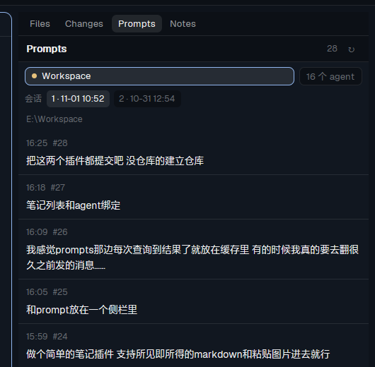

# herdr-app-mod-prompts



A log of what you asked each agent, read from the agent's own session file: time, text, and — on
click — the pictures it carried and the files and links it pointed at.

## Install

Ask your agent in Herdr:

```text
Read ~/.config/herdr-app/AGENTS.md, then add the mod at https://github.com/AlanWanco/herdr-app-mod-prompts
```

Or by hand: copy `mods/prompts/` into `~/.config/herdr-app/mods/`, add
`"alt-p": "mod.open:prompts"` to `global` in `~/.config/herdr-app/keys.json`, and run
`herdr-app check ~/.config/herdr-app/mods/prompts`.

## What it does

- **One list per agent.** The panel follows the agent in front (`focused().agent`); switching agents
  switches the list, and the tab survives a space switch while it is the shown panel.
- **Reads omp's own logs**: `~/.omp/agent/sessions/<folder>/<session>.jsonl`, on this machine and on
  any machine `hc machine ls` knows. A folder with several sessions gets numbered session chips with
  their start times.
- **Kept**: every read is merged into `~/.config/herdr-app/cache/prompts/data/<agent>__<session>.json`
  (deduplicated, up to 4,000 messages), so scrolling back is not lost when a switch or a restart
  happens. `更早` quadruples how much of a remote log is read (2 MB → 8 MB → 32 MB).
- **Click a message** for the whole text, its pictures as thumbnails, and chips for the files and
  links it mentioned; a chip opens a text file as code, a picture as a picture, anything else through
  the system opener. A copy button on hover puts the text on the clipboard; the picture preview's
  copy button puts the image bytes there (WebP is converted with ffmpeg first).
- **Order**: pinned agents first (the pins the shipped agents list stores), then working, blocked,
  done, the rest.

## Requirements

- Windows: `powershell` for reading local logs and for the clipboard image. No other dependency.
- macOS/Linux: `sh`, `tail`, `grep` for remote logs.
- `ffmpeg` is optional: it converts WebP pictures when copying them to the clipboard.

## Notes

The panel tab needs a stack child and a label; this mod does not add it. In the default layout, add
`{"id":"prompts","type":"block","content":{"mod":"prompts"}}` to the `panel-body` stack of a cloned
layout (as `mods/panel-tabs` does for the tab strip), or use `alt-p` for the floating window.

MIT licensed.
